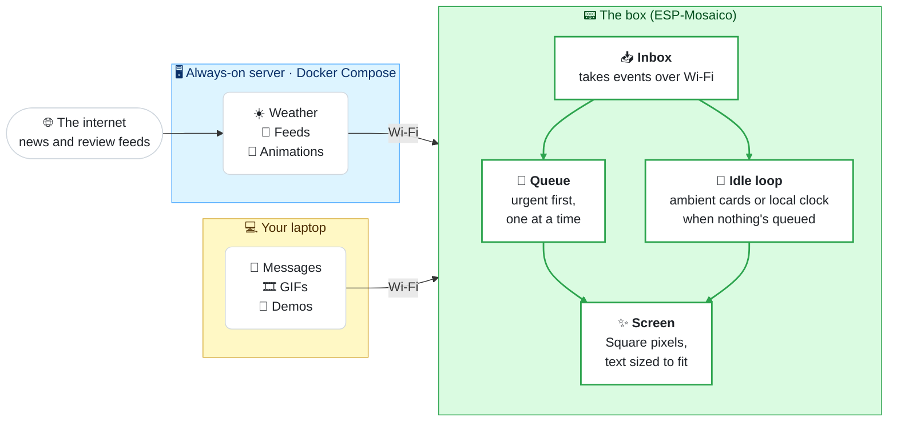

# box

<p align="center">
    
</p>

An [ESP-Mosaico](https://mosaico.ai/en) on your desk that shows whatever you
send it on its 480×480 screen: real text, images, or an LED-panel look. The box
itself only does the core: it receives events over Wi-Fi, decides what gets the
screen, and draws it. Everything with an opinion about *content* — weather, feeds, GIFs — is a
connector on some other machine that POSTs to it.



Any machine on the network can be a connector. If the one running the sources
goes down, start them anywhere else: the box doesn't care who talks to it.

## Start

The board needs the box firmware once (`mise run install`, see
[Firmware](#firmware)) and Wi-Fi, which it takes from the Mosaico's own Vibe
Mode settings. At boot it shows its address and answers at **http://box.local**.
When nothing else is on, it shows the time.

```bash
mise run send -- --title Hi "hello"   # some text, now
mise run demo -- beer                  # rainbow, life, gradient, beer
mise run gif -- party.gif              # a GIF
mise run status                        # what is on screen
mise run server                        # weather and feeds, on the server
mise tasks                             # everything else
```

Those run [`box-services`](connectors/box-services), one Go program. The tasks
are in [`mise.toml`](mise.toml), which also pins Go: with
[mise](https://mise.jdx.dev) installed, `mise install` gets it. The server
needs only Docker. If `box.local` does not
resolve on your network, put the box's IP in a `.env` (copy
[.env.example](.env.example)): `BOX_URL=http://192.168.0.228`.

## Sending something

```bash
curl -H 'Content-Type: application/json' -d '{
  "source": "discord", "priority": "alert",
  "content": {"type": "text", "title": "Discord", "text": "@theo mentioned you"}
}' http://box.local/api/events
```

An event says *what* to show, never how many pixels: the box lays text out,
scales images to fit and picks colours. No colour in that payload: the box
knows Discord is blurple.

| Content | Fields | |
| --- | --- | --- |
| `text` | `text`, `title`?, `color`?, `align`? (`center`, `left`) | Word-wrapped as large as it fits, never scrolled; `\n` breaks a line; with a title, the title takes the colour and the text is white |
| `image` | `width`, `height`, `data`, `fps`? (12), `loop`? (true), `scaling`? (`pixelated`, `smooth`) | `data` is base64 RGB frames; any size, fitted to the screen |
| `color` | `color` | The whole screen |
| `clear` | | Black |

| Event field | |
| --- | --- |
| `source` | Who it is from: picks the colour, and keeps one pending event per source |
| `priority` | `alarm` always takes the screen · `alert` takes it unless another instant event is up, then shows next · `normal` (default) queues · `ambient` joins the idle rotation |
| `duration` | Seconds on screen; leave it out for the priority's default |
| `style` | `smooth` or `led` for this event; leave it out for the display's |

Bursts stay readable: pings line up instead of shoving each other off
screen, and an interrupted event comes back with the time it had left.

| Endpoint | |
| --- | --- |
| `POST /api/events` | Show something |
| `DELETE /api/events` | Drop the queue and what is showing |
| `DELETE /api/ambient` | Empty the idle rotation |
| `GET /api/status` | What is on screen, the queue, the rotation, measured frame rates |
| `GET /api/display` | What this display can do: size, shape, content types, styles, limits |
| `PATCH /api/display` | `{"brightness": 0.6, "style": "led"}`, until the next reboot |

Errors are `{"detail": "..."}`: 422 for an invalid event, 503 when the queue,
the rotation or image memory is full.

## What runs where

**On the box: only the core.** [`core/`](core) validates events, schedules
them and draws them, in portable C (tested on any machine).
[`mosaico/`](mosaico) adds the screen driver, Wi-Fi, HTTP and the clock. Its
state is memory: after a reboot the queue and rotation are empty until the
services post again (the weather refreshes every minute).

**On a server that stays on:** [`box-services`](connectors/box-services) in
Docker (`mise run server`, or `docker compose up -d --build`): the weather, RSS
feeds, and visuals rendered to images. Compose uses the host network to reach
`box.local` over mDNS and keeps feed history in a named volume. If that
server goes down, run it anywhere else: the box does not care who talks to it.

**Anywhere else:** the same `box-services` binary sends one-offs, or `curl`
does. There is no SDK to keep in sync.

## Firmware

[`mosaico/`](mosaico) is an ESP-IDF application for the ESP-Mosaico. It
builds against an [esp-mosaico-vibe](https://github.com/esp-mosaico/esp-mosaico-vibe)
workspace (board support, ESP-Iris, install tooling), set up per its README.
Point `MOSAICO_WORKSPACE` at it in `.env`, plug the board in over USB, and:

```bash
mise run install      # build and install (keeps the Mosaico's Vibe Mode intact)
mise run logs         # follow the board's log
mise run screenshot   # save the screen to box.png
```

Hold the AI button while powering on to get back to Vibe Mode. Build options
(hostname, a bearer token for writes, the default style, the LED grid, time
zone) are in [mosaico/README.md](mosaico/README.md).

## Development

```bash
mise run check    # the core's tests (ASan/UBSan); box-services' gofmt, vet, tests
mise run format
```

See [AGENTS.md](AGENTS.md) for the layout and the rules that keep it simple.
