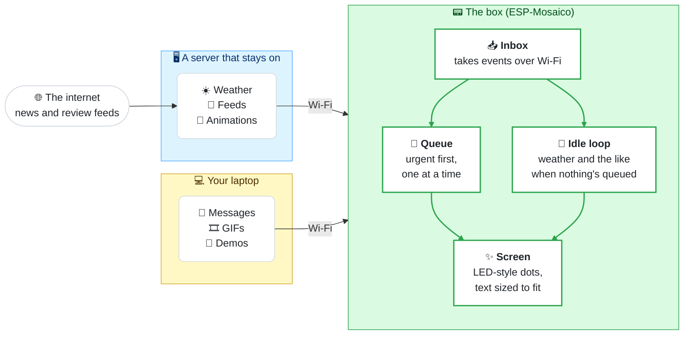

# box

<p align="center">
    
</p>

An [ESP-Mosaico](https://mosaico.ai/en) on your desk that shows whatever you
send it, drawn as an LED panel on its screen. The box itself only does
the core: it receives events over Wi-Fi, decides what gets the panel, and draws
it. Everything with an opinion about *content* — weather, feeds, GIFs — is a
connector on some other machine that POSTs to it.



Any machine on the network can be a connector. If the one running the sources
goes down, start them anywhere else: the box doesn't care who talks to it.

## Start

The board needs the box firmware once (`make install`, see
[Firmware](#firmware)) and Wi-Fi, which it takes from the Mosaico's own Vibe
Mode settings. At boot it shows its address on the panel and answers at
**http://box.local**.

```bash
make send TEXT="hello"   # some text, now
make demo VISUAL=beer    # a built-in visual: rainbow, life, gradient, beer
make gif GIF=party.gif   # a GIF
make sources             # weather and feeds, until stopped
make status              # what the panel shows
```

The connectors need [uv](https://docs.astral.sh/uv/) and nothing else. If
`box.local` does not resolve on your network, put the box's IP in a `.env`
(copy [.env.example](.env.example)): `BOX_URL=http://192.168.0.228`.

## Sending something

```bash
curl -H 'Content-Type: application/json' \
     -d '{"source":"discord","priority":"alert",
          "scene":{"kind":"text","text":"@theo mentioned you"}}' \
     http://box.local/api/events
```

No colour in that payload: the box knows Discord is blurple. Connectors send
*what happened*; the box owns how it looks.

| Priority | |
| --- | --- |
| `alarm` | Always takes the panel, interrupting even an alert |
| `alert` | Takes it too — unless an instant event is already up, then it shows next |
| `normal` | Queued behind any waiting alerts |
| `ambient` | Joins the idle rotation, never interrupts |

Two instant tiers so a burst stays readable: pings line up behind each other
instead of each shoving the last off screen. One pending event per source, so
ten pings do not buy eighty seconds of panel time. An interrupted event comes
back with the time it had left.

Scenes are `text`, `frames` (your own RGB animation: `width`, `height`, `fps`,
`loop`, base64 `data`; any size, scaled to the panel), `solid` and `blank`.
Text never scrolls: it is word-wrapped and drawn as large as it fits, so a
short word fills the panel and a paragraph gets small; `\n` forces a line
break, and only text too long for even the smallest size is cut with `...`.
`duration` is seconds on the panel; leave it out for the priority's default.

Visuals are rendered by the sender, not the box: `box-sources visual beer` (or
`make demo`) draws the pour at the size the box reports and sends it as frames.

| Endpoint | |
| --- | --- |
| `POST /api/events` | Submit an event |
| `DELETE /api/events` | Drop queued events |
| `GET /api/display` | What's on the panel, its size, and measured `drawn_fps`/`shown_fps` |
| `POST /api/display/clear` | Drop the queue and the idle rotation |
| `POST /api/display/brightness` | `{"brightness": 0.0–1.0}`, until the next reboot |

Errors come back as `{"detail": "..."}`: 422 for an invalid event, 503 when the
queue, the rotation or animation memory is full.

## What runs where

**On the box: only the core.** Receiving, validating, the scheduler and
drawing. Its state is memory: after a reboot the queue and the idle rotation
are empty until connectors post again (the weather refreshes every minute).

**Everywhere else: content.** [`connectors/sources`](connectors/sources) is
weather, RSS/Atom feeds and the visual generators, as one long-running service
— a systemd user unit for whichever machine you leave on.
[`connectors/gifcast`](connectors/gifcast) converts a GIF on your disk. Anything
that can run `curl` is a connector; there is no SDK to keep in sync.

## Firmware

[`firmware/`](firmware) is an ESP-IDF application for the ESP-Mosaico. It
builds against an [esp-mosaico-vibe](https://github.com/esp-mosaico/esp-mosaico-vibe)
workspace (board support, ESP-Iris, install tooling), set up per its README.
Point `MOSAICO_WORKSPACE` at it in `.env`, plug the board in over USB, and:

```bash
make install      # build and install (keeps the Mosaico's Vibe Mode intact)
make logs         # follow the board's log
make screenshot   # save the panel to box.png
```

Hold the AI button while powering on to get back to Vibe Mode. Build options
(hostname, a bearer token for writes, panel size, frame rate) are in
[firmware/README.md](firmware/README.md).

## Development

```bash
make check    # firmware core tests (on this machine, under ASan) + connectors
make format
```

The firmware's core — event contract, scheduler, scenes, the LED look — is
portable C, built and tested on this machine by `make check`, which also
keeps it free of ESP-IDF. Only `box_device` touches ESP-IDF or hardware. See
[AGENTS.md](AGENTS.md) for the layout.
