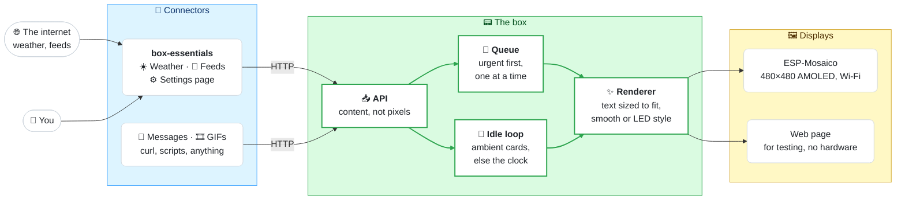

# box

<p align="center">
    
</p>

A little screen on your desk that shows whatever you send it: messages,
the weather, a GIF, a pint for every new bar review. You POST *content*
(text, an image, a colour) to its HTTP API; the box decides what gets the
screen, lays it out and draws it, as crisp text or an LED-panel look. When
nothing is on, it shows the time.

The box is the part in the middle: an API, a queue and a renderer, in
portable C. What it draws on is a **display**, and what feeds it is a
**connector**. Both are swappable.



## Try it

All you need is Docker, git and [mise](https://mise.jdx.dev). `mise run setup`
fetches the rest at pinned versions ([`toolchain/versions`](toolchain/versions))
into a dev container; every task runs there.

```bash
mise run web                           # the box in a browser: http://localhost:8080
BOX_URL=http://localhost:8080 mise run send -- --title Hi "hello"
```

With real hardware the box answers at **http://box.local**, and the same
commands work without `BOX_URL`:

```bash
mise run send -- --title Hi "hello"   # some text, now
mise run demo -- beer                  # rainbow, life, gradient, beer
mise run gif -- party.gif              # a GIF
mise run status                        # what is on screen
mise run server                        # weather and feeds, on a server (settings on :8090)
mise tasks                             # everything else
```

If `box.local` does not resolve on your network, put the box's address in a
`.env` (copy [.env.example](.env.example)): `BOX_URL=http://192.168.0.228`.

## Displays

| Display | | |
| --- | --- | --- |
| [Web page](displays/web) | `mise run web` | The core with a small HTTP server; the screen is a canvas in your browser. For trying things and testing connectors without hardware |
| [ESP-Mosaico](displays/mosaico) | `mise run install` | A 480×480 AMOLED desk display with Wi-Fi. The box runs on the board itself; settings in [its README](displays/mosaico/README.md) |

A display gives the core a size and a function that takes finished frames
([`core/include/box/display.h`](core/include/box/display.h)), and serves the
API with the core's own JSON helpers. Everything about *what* is shown stays
in [`core/`](core), tested on any machine; adding a display (an LED matrix on
a Raspberry Pi, say) does not touch it.

## Sending something

```bash
curl -H 'Content-Type: application/json' -d '{
  "source": "discord", "priority": "alert",
  "content": {"type": "text", "title": "Discord", "text": "@theo mentioned you"}
}' http://box.local/api/events
```

An event says *what* to show, never how many pixels: the box lays text out,
scales images to fit and picks colours. No colour in that payload: the box
knows Discord is blurple.

| Content | Fields | |
| --- | --- | --- |
| `text` | `text`, `title`?, `color`?, `align`? (`center`, `left`) | Word-wrapped as large as it fits, never scrolled; `\n` breaks a line; with a title, the title takes the colour and the text is white |
| `image` | `width`, `height`, `data`, `fps`? (12), `loop`? (true), `scaling`? (`pixelated`, `smooth`) | `data` is base64 RGB frames; any size, fitted to the screen |
| `color` | `color` | The whole screen |
| `clear` | | Black |

| Event field | |
| --- | --- |
| `source` | Who it is from: picks the colour, and keeps one pending event per source |
| `priority` | `alarm` always takes the screen · `alert` takes it unless another instant event is up, then shows next · `normal` (default) queues · `ambient` joins the idle rotation |
| `duration` | Seconds on screen; leave it out for the priority's default |
| `style` | `smooth` or `led` for this event; leave it out for the display's |

Bursts stay readable: pings line up instead of shoving each other off
screen, and an interrupted event comes back with the time it had left.

| Endpoint | |
| --- | --- |
| `POST /api/events` | Show something |
| `DELETE /api/events` | Drop the queue and what is showing |
| `DELETE /api/ambient` | Empty the idle rotation |
| `GET /api/status` | What is on screen, the queue, the rotation, measured frame rates |
| `GET /api/display` | What this display can do: size, shape, content types, styles, limits |
| `PATCH /api/display` | `{"brightness": 0.6, "style": "led"}`, until the next reboot |

Errors are `{"detail": "..."}`: 422 for an invalid event, 503 when the queue,
the rotation or image memory is full.

## Connectors

Anything that can POST is a connector; there is no SDK to keep in sync.

**[box-essentials](connectors/box-essentials)** runs on a server that stays on,
in Docker (`mise run server`, or `docker compose up -d --build`): the real
weather (Open-Meteo) as an ambient card, and RSS feeds. Set it up on its
page, **http://&lt;the server&gt;:8090**: where the weather is for, which feeds to
follow, where the box is. The same program sends one-offs from the command
line (`mise run send`, `demo`, `gif`).

The box keeps only memory: after a restart its queue and rotation are empty
until connectors post again. The clock is the box's own, so it keeps time
when every connector is down; and if the server goes down, run
box-essentials anywhere else.

## Development

```bash
mise run check    # the core's tests (ASan/UBSan); box-essentials' gofmt, vet, tests
mise run format
```

See [AGENTS.md](AGENTS.md) for the layout and the rules that keep it simple.
